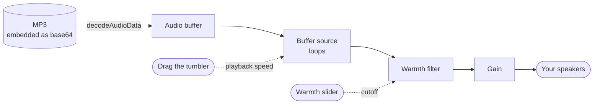

<div align="center">


### Side A is the website. Side B is the receipt.

[](https://YOUR-USERNAME.github.io/YOUR-REPO/)


</div>

---

> **Liner notes.** A café you remember has three things: something good in your hand, a record turning in the corner, and a slip of paper to take home. Twelfth Night is a single HTML page that tries to be all three. Pour a drink in 3D, drop the needle on a real record, and walk out with a receipt.

<div align="center">

<br>
<sub>The cover shot: drag the tumbler, pick a pressing, drop the needle.</sub>
</div>

---

## 💿 Tracklist

```
==============================================
        TWELFTH NIGHT  ·  TN-001  ·  STEREO
==============================================
 SIDE A  ·  THE SITE
----------------------------------------------
 01  Hero ........ 3D tumbler · flavor carousel
                   · the vinyl deck
 02  Menu & Roast  filter by roast stage
                   · drink customizer
 03  Origins ..... the story timeline
----------------------------------------------
 SIDE B  ·  THE RECEIPT
----------------------------------------------
 04  Order & Booths pickup · tasting bar
                   · wholesale · receipt
 05  Launch Week . five nights, one calendar
==============================================
```

The numbers match the site's own navigation, so you can follow along track by track.

---

## 🎚️ The pressings

Three flavors, three records. Pick one and the whole page re-themes: palette, accents and hero copy.

| # | Pressing | Pour | Price | Mood |
|---|---|---|---|---|
| 01 | **D-Min Rhodes** · 78 BPM | Espresso Velvet | ₹280 | warm and dark |
| 02 | **Kyoto Ambient** · 68 BPM | Uji Matcha Cloud | ₹310 | slow and green |
| 03 | **Shibuya Groove** · 92 BPM | Cascara Berry Nitro | ₹295 | bright and berry |

---

## 🎧 How to listen

```
 1  Open the site and let the loading veil lift.
 2  Drag the tumbler to turn it in 3D.
 3  Tap a pressing in the carousel. Watch the colors move.
 4  Hit DROP NEEDLE on the vinyl deck.
 5  Drag the tumbler again. The record speeds up and
    slows down, and the pitch bends with it.
 6  Slide WARMTH from muffled to bright.
 7  Lift the needle. It pauses where it stopped.
```

Now spinning: *Theme from A Summer Place* by Percy Faith, on loop. Sound effects (clicks, fizz, stamp) are on by default.

---

## 🧾 Tucked in the sleeve

Every order prints a live thermal-style receipt. Add an Espresso Velvet and an Uji Matcha Cloud and you get:

```
==========================================
   TWELFTH NIGHT — DEHRADUN
   Rajpur Road, Dehradun · 07:30–22:30
==========================================
TOKEN : #TN-4821
------------------------------------------
1x Espresso Velvet — INR 280.00
1x Uji Matcha Cloud — INR 310.00
------------------------------------------
SUBTOTAL : INR 590.00
GST (5%) : INR 29.50
TOTAL    : INR 619.50
==========================================
```

<details>
<summary><b>🪪 Three ways to order</b></summary>

<br>

| Mode | What it's for |
|---|---|
| **Café Pickup** | Order drinks to collect |
| **Tasting Bar Seat** | Book a counter seat, an acoustic pair or a corner listening booth |
| **Wholesale Beans** | For cafés, studios and businesses |

After confirming you can **copy the token**, **download a `.txt` receipt**, **download a calendar `.ics` invite**, or send the order over **WhatsApp**. The form checks the name, a 10-digit Indian mobile number, and a time between 07:30 and 22:30.

</details>

---

## 🎛️ Mastering chain

How the record gets from the file to your speakers:



<sub>Dragging changes the playback speed of the buffer, which is what bends the pitch. The warmth slider moves the filter cutoff.</sub>

---

## 📝 Credits

```
==============================================
                  PERSONNEL
==============================================
 Structure, style, logic .. one HTML file
 Motion .................. GSAP 3.12
 The tumbler ............. Three.js 0.170
 Audio engine ............ Web Audio API
 Typefaces ............... Cormorant Garamond,
                           Oswald, Space Grotesk
 Recording ............... Percy Faith
 Composer ................ Max Steiner
==============================================
```

GSAP loads from cdnjs, Three.js from jsDelivr and the fonts from Google Fonts, so the first visit needs an internet connection.

---

## 🛠️ Press your own copy

No install needed.

```bash
git clone https://github.com/YOUR-USERNAME/YOUR-REPO.git
cd YOUR-REPO
open index.html        # Mac · use `start index.html` on Windows
```

Or serve it locally:

```bash
python3 -m http.server 8000
# then open http://localhost:8000
```

<details>
<summary><b>Deploy on GitHub Pages</b></summary>

<br>

1. Push `index.html` and the `docs/` folder to your main branch.
2. Go to **Settings → Pages**.
3. Under **Build and deployment**, choose **Deploy from a branch**, select `main` and `/ (root)`, then save.
4. After a minute or two the site is live at the URL on that page.

To update later, replace `index.html` and commit. Hard-refresh (`Ctrl/Cmd + Shift + R`) if you still see the old version.

</details>

<details>
<summary><b>Swap the record</b></summary>

<br>

The MP3 sits in a `<script type="text/plain" id="tn-track-b64">` block as base64. Replace its contents with your own file:

```bash
base64 -w0 yourfile.mp3
```

</details>

<details>
<summary><b>Floor plan</b></summary>

<br>

```
.
├── index.html          # the whole site, including the embedded MP3
├── README.md
└── docs/
    ├── banner.svg      # animated sleeve header
    └── screenshot.png
```

</details>

---

## 🎙️ Producer's notes

- **One file, no build.** The whole site is a single HTML page, so it goes live by dropping it on GitHub Pages.
- **Web Audio, not an `<audio>` tag.** The song is decoded into a buffer so it plays reliably in every browser, and so the filter and pitch bend can act on it directly.
- **Decoded early.** The MP3 is decoded in the background after load, so the first needle drop is instant.
- **Sound after a tap.** Browsers block audio until your first click or tap, so nothing plays on load.
- **Gentle on motion.** Animation follows `prefers-reduced-motion`, and the header has a motion toggle.
- **A heavy record.** The page is about 3 MB because the song is embedded. The first load is slower on weak connections.

---

## ⚖️ Rights

*Theme from A Summer Place* is a recording by Percy Faith, composed by Max Steiner. It is third-party copyrighted material, included here for demonstration and personal use only. Swap in licensed or royalty-free music before any commercial use.

---

<div align="center">

```
==============================================
        THANKS FOR LISTENING · COME BACK
        Rajpur Road, Dehradun · 07:30–22:30
==============================================
```

Pressed by **[YOUR NAME](https://github.com/YOUR-USERNAME)** · **[Play the record →](https://YOUR-USERNAME.github.io/YOUR-REPO/)**

</div>
